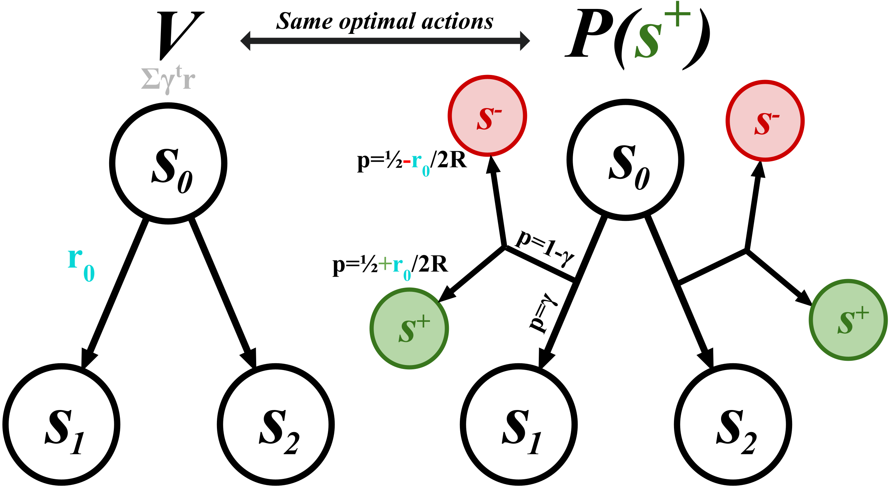

[Full report (PDF)](/assets/success-functions.pdf)

Here is a project that I worked on in Chelsea Finn's lab at Stanford, with
advising from Lucy Shi. The empirical results weren't strong enough to appear
in a conference paper, but I felt that the result is conceptually interesting
enough to post here.

Reinforcement learning typically deals with producing agents that make
decisions to accumulate as many rewards as possible. These rewards are
typically scalars (e.g., 5.6 or −1) received at every time step, and the idea
is to maximize the sum of the rewards. More specifically, a common way to
think about this is to maximize a discounted sum of rewards, where future
rewards matter less than current ones (i.e., discounted reward maximization).

The theoretical result that I derived below, which is the first that I'm aware
of, shows that any discounted reward maximization problem can be framed as an
equivalent problem where, instead of having the agent pursue the accumulation
of rewards, there is a single goal state that the agent tries to maximize the
probability of reaching.

Roughly, the derivation follows by taking the rewards in the original Markov
decision process (MDP) and using them to produce probabilities of
transitioning to the goal state in a modified MDP (the larger the reward, the
larger the probability of transitioning to the goal state).

  

*A discounted scalar-reward MDP (left) and its
success MDP (right). The success MDP keeps the original states and
transitions but, at every step, terminates with probability $$1-\gamma$$ into
one of two absorbing states: the success state $$s^+$$ with probability
$$\tfrac{1}{2}+\tfrac{r}{2R}$$, and the failure state $$s^-$$ otherwise. The
probability of eventually reaching $$s^+$$ is a positive affine transformation
of the value function in the original MDP, so the two problems share the same
optimal actions.*

## Derivation

**Setup.** Consider an MDP with state space $$\mathcal{S}$$, action space
$$\mathcal{A}$$, transition kernel $$P(s' \mid s, a)$$, bounded reward
function $$r(s, a) \in [-R, R]$$ for some $$R > 0$$, discount
$$\gamma \in [0, 1)$$, and a set of terminal states
$$\mathcal{S}_T \subseteq \mathcal{S}$$. Let $$\tau$$ denote the first time a
terminal state is reached. The objective is to find a policy $$\pi$$ maximizing the expected
discounted return

$$
V^\pi(s_0) = \mathbb{E}_\pi\left[\sum_{t=0}^{\tau - 1} \gamma^t\, r(s_t, a_t)\right].
$$

**The success MDP.** Add two absorbing states, $$s^+$$ (success) and $$s^-$$
(failure). From any non-terminal state $$s \notin \mathcal{S}_T$$, under
action $$a$$, the next state is

$$
s' \sim \begin{cases}
P(\cdot \mid s, a) & \text{with probability } \gamma, \\[4pt]
s^+ & \text{with probability } (1-\gamma)\left(\dfrac{1}{2} + \dfrac{r(s,a)}{2R}\right), \\[8pt]
s^- & \text{with probability } (1-\gamma)\left(\dfrac{1}{2} - \dfrac{r(s,a)}{2R}\right).
\end{cases}
$$

Upon reaching any terminal state $$s \in \mathcal{S}_T$$, transition
immediately to $$s^+$$ or $$s^-$$ each with probability $$\tfrac{1}{2}$$.

**Theorem.** For any policy $$\pi$$,

$$
P^\pi(s^+ \mid s_0) = \frac{1-\gamma}{2R}\,V^\pi(s_0) + \frac{1}{2}.
$$

Since $$\frac{1-\gamma}{2R} > 0$$, maximizing the probability of reaching
$$s^+$$ is equivalent to maximizing $$V^\pi(s_0)$$: the success MDP and the
original MDP share the same optimal policies.

**Proof.** Fix a policy $$\pi$$ and a trajectory
$$(s_0, a_0, s_1, a_1, \ldots)$$ that first reaches $$\mathcal{S}_T$$ at step
$$\tau$$. The agent enters $$s^+$$ either by discount-termination at some step
$$t < \tau$$ or by the final transition at step $$\tau$$ with probability
$$\tfrac{1}{2}$$. Conditioning
on the trajectory,

$$
P^\pi(s^+ \mid s_0) = \mathbb{E}_\pi\left[\sum_{t=0}^{\tau-1} \gamma^t(1-\gamma) \left(\frac{1}{2} + \frac{r(s_t,a_t)}{2R}\right) + \gamma^\tau \cdot \frac{1}{2}\right].
$$

Split the sum into two parts:

$$
\sum_{t=0}^{\tau-1} \gamma^t(1-\gamma)\left(\frac{1}{2} + \frac{r(s_t,a_t)}{2R}\right) = \frac{1}{2}(1-\gamma)\sum_{t=0}^{\tau-1}\gamma^t + \frac{1-\gamma}{2R}\sum_{t=0}^{\tau-1}\gamma^t\, r(s_t,a_t).
$$

The first term is a geometric series,
$$\tfrac{1}{2}(1-\gamma)\sum_{t=0}^{\tau-1}\gamma^t = \tfrac{1}{2}(1 - \gamma^\tau)$$,
which combines with the terminal term to give
$$\tfrac{1}{2}(1-\gamma^\tau) + \tfrac{1}{2}\gamma^\tau = \tfrac{1}{2}$$
for every trajectory, regardless of $$\tau$$. Therefore

$$
P^\pi(s^+ \mid s_0) = \frac{1}{2} + \frac{1-\gamma}{2R}\,\mathbb{E}_\pi\left[\sum_{t=0}^{\tau-1}\gamma^t\, r(s_t,a_t)\right] = \frac{1}{2} + \frac{1-\gamma}{2R}\,V^\pi(s_0). \qquad \blacksquare
$$

**Learning the success probability.** The success probability also satisfies
a Bellman recursion. With probability $$1-\gamma$$ the episode resolves
immediately, with the reward setting the split between success and failure;
with probability $$\gamma$$ it continues to the next state:

$$
P^\pi(s^+ \mid s_t) = \mathbb{E}\left[(1-\gamma)\left(\frac{1}{2}+\frac{r(s_t,a_t)}{2R}\right) + \gamma\, P^\pi(s^+ \mid s_{t+1})\right].
$$

For a sampled transition $$(s, a, r, s')$$ and a target network $$\bar{P}$$,
the bootstrapped target
$$y = (1-\gamma)\left(\tfrac{1}{2} + \tfrac{r}{2R}\right) + \gamma\,\bar{P}(s^+ \mid s')$$
lies in $$[0, 1]$$, so the critic can be trained with a binary cross-entropy
loss on a sigmoid output, as a classifier rather than a regressor.

The [full report](/assets/success-functions.pdf) also covers asymmetric
reward bounds, a Bayesian interpretation of the actor update, a
Beta-distributional variant of the critic, and the experiments.
